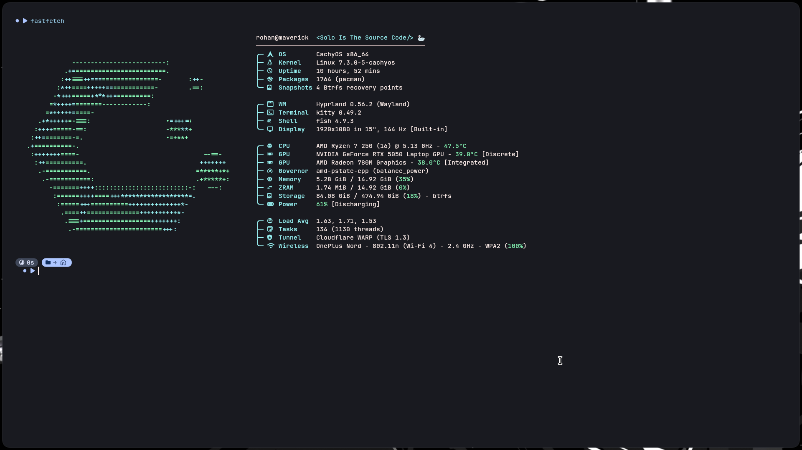

<div align="center">

# Maverick Dotfiles
### `<Solo Is The Source Code/>`


*A low-latency, keyboard-centric Wayland workstation engineered for CachyOS—featuring modular Lua window management, kernel-level `keyd` input layers, and a silent TTY1 boot pipeline.*

<br>



</div>

---

## ⌨️ Hardware Input Architecture (`keyd`)

Standard 75% keyboards sacrifice the dedicated Numpad for desk space. **Maverick** solves this at the Linux kernel `evdev`/`uinput` level using `keyd` (`/etc/keyd/default.conf`), transforming the right-hand navigation column and cluster into a zero-latency hardware Numpad layer that works across TTY and Wayland alike:

```text
┌─────────────────────────────────────────────────────────────────────────┐
│  75% KEYBOARD — RIGHT-HAND NAVIGATION CLUSTER REMAPPED VIA KEYD         │
├──────────────────────────────────┬──────────────────────────────────────┤
│        PHYSICAL KEYCAPS          │         REMAPPED NUMPAD LAYER        │
│                                  │                                      │
│   [ INS ]  [ HOME ]  [ PGUP ]    │      [ KP_7 ]  [ KP_8 ]  [ KP_9 ]    │
│   [ DEL ]  [ END  ]  [ PGDN ]    │      [ KP_4 ]  [ KP_5 ]  [ KP_6 ]    │
│            [  UP  ]              │      [ KP_1 ]  [ KP_2 ]  [ KP_3 ]    │
│   [ LEFT ] [ DOWN ]  [ RGHT ]    │                [ KP_0 ]  [ KP_. ]    │
└──────────────────────────────────┴──────────────────────────────────────┘
```

---

## ⚡ Silent TTY1 Boot Pipeline

No bloated graphical display managers (`SDDM`, `GDM`, or `LightDM`). The system boots straight into raw `tty1` and executes a silent, fault-tolerant handoff to Wayland:

```text
[ Systemd tty1 ] ──► [ Fish Login ] ──► [ exec start-hyprland >/dev/null 2>&1 ]
                                                │
                                                ├──► [ SUCCESS ] ──► Clean Wayland Session
                                                └──► [ FAILURE ] ──► Dump Crash Log to ~/.cache/hyprland.log
```

---

## 🧩 Core Engineering Highlights

* **Modular Lua Hyprland Engine:** Cleanly decoupled configuration split across `general.lua`, `keybinds.lua`, `rules.lua`, and `variables.lua`, paired with custom Ollama AI buffer query scripts and Fuzzel launchers.
* **Fish Shell & XDG Automation:** Instant `xdg-open` aliases, directory abbreviations, and a single-command `backup-os` Git synchronization pipeline.
* **Declarative State Sync:** Uses a zero-symlink Git bare repository (`~/.dotfiles`) paired with an automated `pacman -Qqe` package manifest and `/etc/keyd` privilege bridge.

---

## 🛠️ System Specifications

| Subsystem | Implementation | Config Path |
| :--- | :--- | :--- |
| **OS / Kernel** | CachyOS x86_64 (`linux-cachyos`) | `amd-pstate-epp` |
| **Compositor** | Hyprland `0.56.2` (Wayland) + `hyprlock` | `~/.config/hypr/` |
| **Terminal & Shell** | `kitty` + `fish 4.9.3` | `~/.config/kitty/` & `~/.config/fish/` |
| **Input Daemon** | `keyd` (`systemd` service) | `/etc/keyd/default.conf` |
| **System Fetch** | `fastfetch` | `~/.config/fastfetch/` |

---

## 🚀 Automated Deployment

Deploy the complete Maverick environment—including all explicit CachyOS packages, `keyd` kernel remaps, and silent TTY boot rules—on a fresh Arch/CachyOS machine with a single command:

```bash
curl -fsSL https://raw.githubusercontent.com/Jodrohan/jodrohan-dotfiles/main/install.sh | bash
```

<details>
<summary><b>🔧 Manual Bare-Repository Checkout (Configs Only)</b></summary>

<br>

If you only want to pull the configuration files without running the full system installer:

```bash
git clone --bare https://github.com/Jodrohan/jodrohan-dotfiles.git $HOME/.dotfiles
alias dotfiles="/usr/bin/git --git-dir=$HOME/.dotfiles/ --work-tree=$HOME"
dotfiles checkout -f
dotfiles config --local status.showUntrackedFiles no
```

</details>

---

## 📂 Repository Topology

```text
maverick-dotfiles/
├── .config/
│   ├── fastfetch/                # Custom ASCII & hardware telemetry layout
│   ├── fish/
│   │   ├── conf.d/               # 99-user-custom.fish (Silent TTY launcher)
│   │   ├── functions/            # backup-os.fish (Automated Git sync engine)
│   │   └── auto-Hypr.fish        # Crash log redirection handler
│   ├── hypr/
│   │   ├── hyprland/             # Modular Lua configs (general, keybinds, rules, vars)
│   │   │   └── scripts/          # Ollama AI queries, snip_to_search, & fuzzel helpers
│   │   └── hyprlock/             # Lockscreen theme & battery/capslock status scripts
│   ├── keyd-backup/              # System /etc/keyd hardware remap mirror
│   ├── kitty/                    # GPU terminal config & Python scroll/search extensions
│   └── pkglist.txt               # Explicit CachyOS package manifest (1,764 packages)
├── assets/
│   └── preview.png               # System showcase screenshot
├── .bash_profile                 # Fallback TTY auto-start wrapper
├── .bashrc                       # Bash environment fallback
└── install.sh                    # Unattended system bootstrap script
```

---

## 🔄 Live Synchronization

To snapshot `/etc/keyd`, export the latest `pacman` package manifest, stage modified configurations, and push to `origin/main`, run from anywhere in Fish:

```fish
backup-os
```


## 🚀 Frameless Web App & Media Keybinds (`--app` Mode)

Integrated directly into Hyprland (`keybinds.lua`) and dynamically parsed by the Quickshell Keybinds Cheatsheet (`Super + /`):

| Shortcut | Application | Execution Engine |
| :--- | :--- | :--- |
| `Super + X` | **YouTube** | `google-chrome-stable --app=https://www.youtube.com` |
| `Super + C` | **Instagram** | `google-chrome-stable --app=https://www.instagram.com` |
| `Super + Z` | **ZapZap (WhatsApp)** | `zapzap` / Flatpak Native Client |
| `Super + Shift + Z` | **Reddit** | `google-chrome-stable --app=https://www.reddit.com` |
| `Super + Alt + X` | **Spotify** | `google-chrome-stable --app=https://open.spotify.com` |

---

## 🛡️ Smart Btrfs Snapshot Architecture (`1 Golden + 3 Rolling`)

Instead of bloated hourly timeline snapshots, system recovery is governed by a deterministic Snapper policy (`/etc/snapper/configs/root` mirrored to `~/.config/snapper-backup/root`) triggered via `backup-os`:

* **1 Immortal Golden Baseline (`#499`):** Permanently pinned clean OS state (`Cleanup: none`) immune to automated pruning.
* **3 Rolling Checkpoints (`NUMBER_LIMIT="3"`):** Every `backup-os` execution creates a fresh recovery checkpoint and automatically prunes any rolling snapshot older than the latest 3.
* **Zero Background Bloat:** `snapper-timeline.timer` is disabled (`TIMELINE_CREATE="no"`) to keep CoW disk usage minimal (~65 GiB).

## Terminal Navigation & CLI Stack

| Shortcut / Command | Tool | Purpose |
| :--- | :--- | :--- |
| `Super + E` / `y` | `yazi` | Async Rust terminal file manager with auto-`cd` on exit |
| `z <dir>` / `zi` | `zoxide` | Frecency directory jumper and interactive picker |
| `Ctrl + T` / `Alt + C` | `fzf` + `fd` | Fast file and directory lookup (excludes `.git`, `.dotfiles`, `.wine`, `.cache`) |
| `Ctrl + R` | `fzf` | Interactive command history search |
| `warp-on` / `warp-off` | `warp-cli` | On-demand Cloudflare WARP tunnel toggle |
